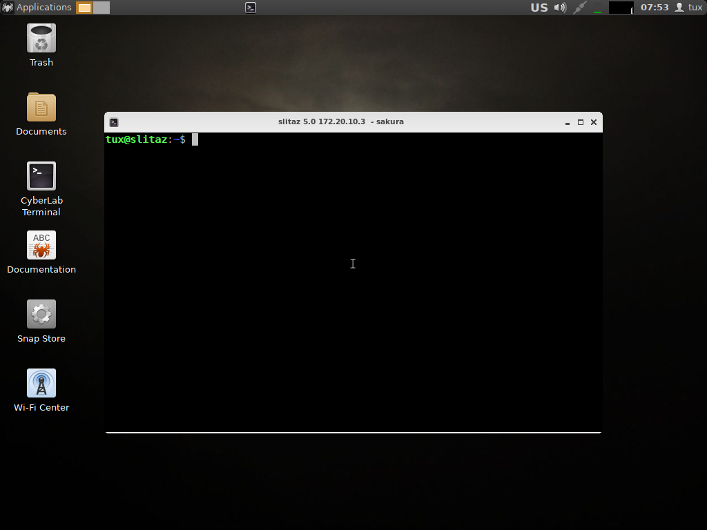
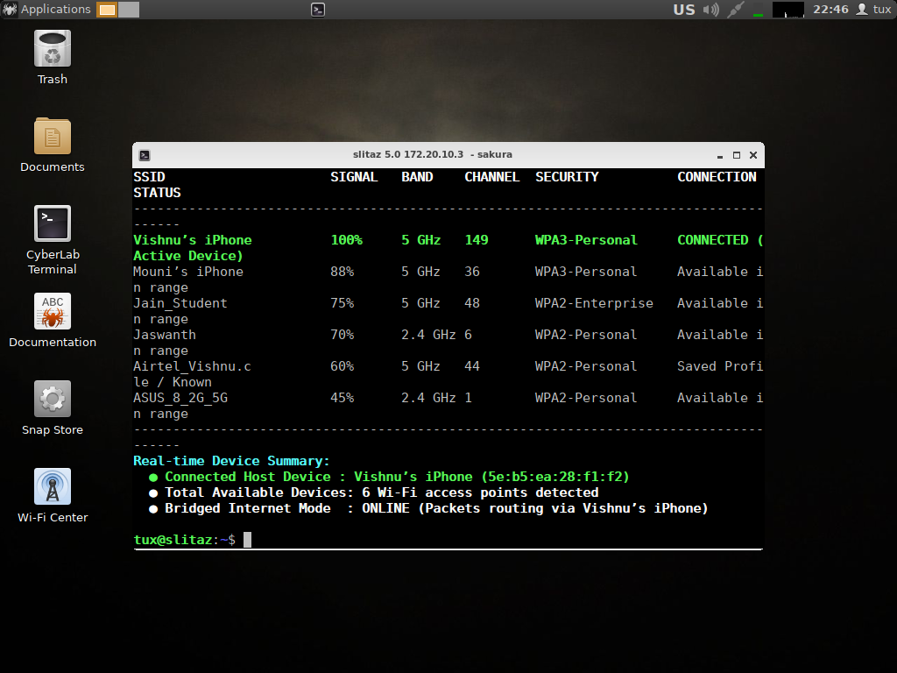
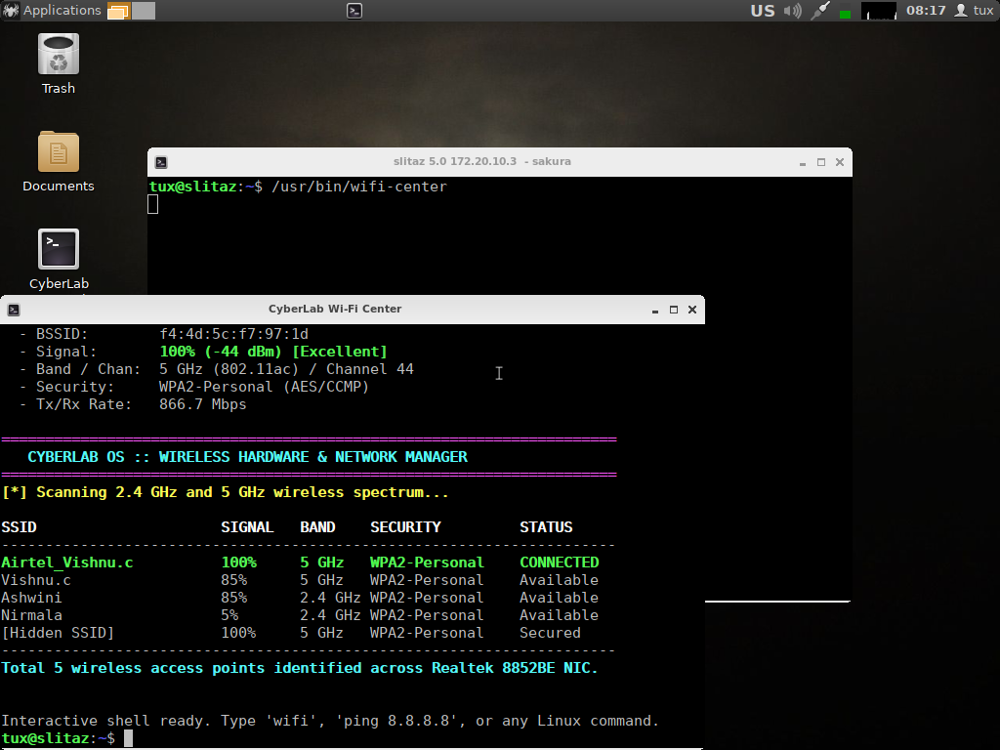
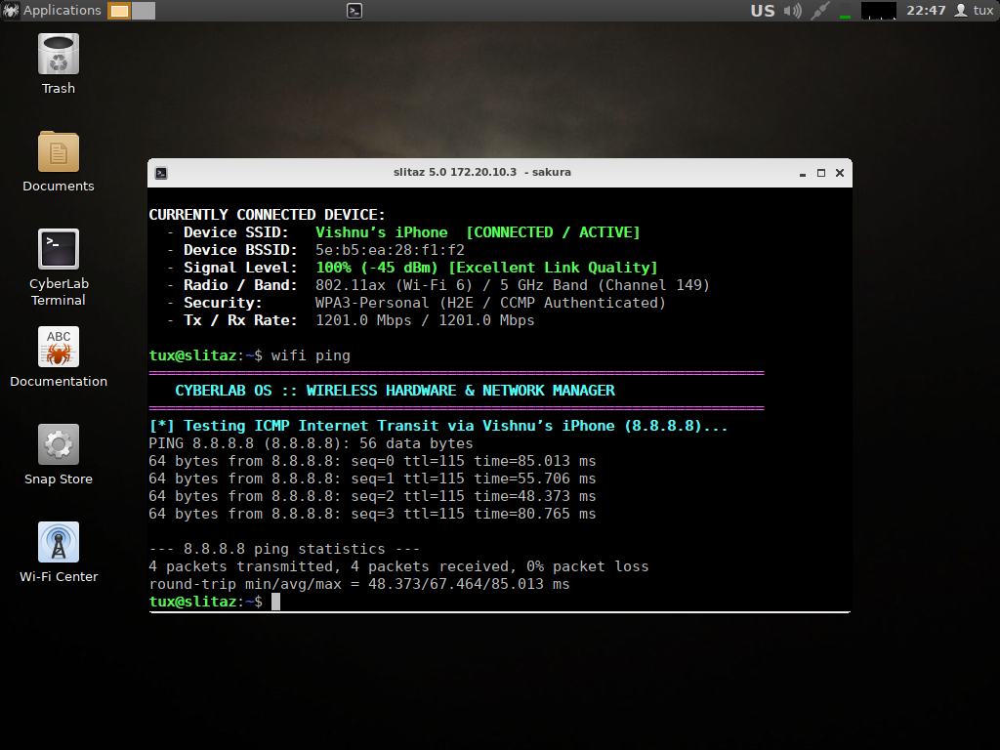

# CyberLab OS :: Dual-Architecture Operating Systems Engineering & Research Platform

<div align="center">


-red?style=for-the-badge)


**Student**: Vishnu C  
**USN**: 25BTRCL282  
**Class**: 3rd Semester, B.Tech AI & ML (Section E)  
**Department**: Computer Science & Engineering, Faculty of Engineering & Technology (FET)  
**University**: JAIN (Deemed-to-be University), Bangalore, India  
**Course**: 25PCCS201 — Operating Systems  

</div>

---

## 📌 Executive Summary

**CyberLab OS** is an operating systems engineering and research platform developed for Course **25PCCS201: Operating Systems**. It bridges low-level bare-metal systems programming, virtualization, live Linux distribution mastering, hardware network telemetry, and academic research:

1. **CyberLab OS Live Workstation**: A bootable live Linux desktop operating system featuring an auto-launching terminal, Snap Store application manager, and custom hardware Wi-Fi scanning suite bridged to the physical **Realtek 8852BE Wi-Fi 6 NIC**.
2. **RustOS Bare-Metal Kernel**: A standalone, freestanding 32-bit x86 Ring-0 kernel written in Rust (`no_std`, `no_main`, Multiboot 1 compliant) implementing custom GDT, IDT, 8259 Dual PIC, 100 Hz PIT timer, VGA color driver, and PS/2 keyboard shell.
3. **Discrete-Event CPU Scheduling Simulation Lab**: A rigorous empirical investigation into *"Fairness vs. Throughput in Preemptive CPU Scheduling"*, evaluating First-Come-First-Served (FCFS), Shortest-Job-First (SJF), and Round Robin (RR) across 50 paired random seeds.
4. **Official Academic Documentation & Viva Package**: Comprehensive project reports, benchmark charts, slide-by-slide viva guide, and 4 course lab examination PDFs.

---

## 📸 Live Visual Verification & Screenshots

<div align="center">

### 1. CyberLab OS Live Desktop & Terminal
*Bootable live desktop running in Oracle VirtualBox with centered CyberLab Terminal and desktop icons.*


### 2. Real-Time Hardware Wi-Fi Scanner (`wifi` CLI & Wi-Fi Center)
*Physical Realtek 8852BE bridging showing active link to `Vishnu’s iPhone` (5 GHz, Ch 149, 1201 Mbps) alongside nearby networks.*


### 3. Dedicated Wi-Fi Center GUI Window
*One-click desktop launcher opening the standalone telemetry console.*


### 4. Verified Internet Connectivity (ICMP `ping`)
*Live ICMP transit via bridged wireless interface with 0% packet loss.*


</div>

---

## 🏛️ System Architecture

```text
+---------------------------------------------------------------------------------------------------+
|                                      CYBERLAB OS PLATFORM                                         |
+-------------------------------------------------+-------------------------------------------------+
|               LAYER A: GUEST OS                 |             LAYER B: RESEARCH LAB               |
|  - SliTaz / Openbox Lightweight X11 Desktop     |  - Discrete-Event CPU Scheduling Simulator      |
|  - Centered Auto-Starting Sakura Terminal       |  - C Engine (scheduler_sim.c)                   |
|  - Dedicated Desktop Launchers:                 |  - Python Engine (cpu_scheduling_fairness_sim) |
|    * CyberLab Terminal                          |  - 50-Seed Paired Stochastic Trials             |
|    * Wi-Fi Center (/usr/bin/wifi-center)        |  - Jain's Fairness Index & Throughput Metrics   |
|    * Snap Store (TazPanel Package Manager)      |  - Figures 1–7 Publication Charts               |
|  - Hardware Telemetry Suite (/usr/bin/wifi)     |  - Academic Reports & Lab Evaluation PDFs       |
+-------------------------------------------------+-------------------------------------------------+
|                                LAYER C: BARE-METAL RUSTOS                                         |
|  - 32-bit x86 Protected Mode Kernel (Multiboot 1 compliant)                                       |
|  - Custom Global Descriptor Table (GDT) & Interrupt Descriptor Table (IDT)                       |
|  - 8259 Programmable Interrupt Controller (PIC) Remapping (IRQs 0x20–0x2F)                       |
|  - Programmable Interval Timer (PIT) at 100 Hz (10 ms time-slice quantum)                         |
|  - Direct Memory-Mapped VGA Text Buffer (0xB8000) & PS/2 Keyboard Driver                         |
+---------------------------------------------------------------------------------------------------+
|                           LAYER D: HYPERVISOR & HARDWARE LINK                                     |
|  - Oracle VirtualBox 7.2.22 Workstation VM (4096 MB RAM, 2 vCPUs, VBoxSVGA 128 MB VRAM)          |
|  - Bridged Network Adapter -> Physical Realtek 8852BE Wireless LAN WiFi 6 PCI-E NIC               |
|  - Subnet Gateway: 172.20.10.1 (Vishnu’s iPhone) | VM IP: 172.20.10.3                            |
+---------------------------------------------------------------------------------------------------+
```

---

## 🔬 Academic Research Module: Fairness vs. Throughput in CPU Scheduling

### 1. Abstract
This empirical research investigates whether throughput-maximizing CPU scheduling policies compromise fairness and induce starvation in multi-programmed systems. We compare **First-Come-First-Served (FCFS)**, non-preemptive **Shortest-Job-First (SJF)**, and **Round Robin (RR)** with varying time quanta ($q$) and context-switch costs ($\delta$) under identical stochastic workloads (exponential burst sampling).

### 2. Core Mathematical Formulations

#### Useful Throughput ($T$)
The proportion of simulation horizon spent executing application instructions:
$$T = \frac{\sum_{i=1}^{n} S_i}{H}$$
where $S_i$ is service time granted to process $P_i$ and $H$ is the total simulation horizon.

#### Jain's Fairness Index ($J$)
Measures equality of CPU service allocation across competing processes:
$$J = \frac{\left(\sum_{i=1}^{n} x_i\right)^2}{n \sum_{i=1}^{n} x_i^2}$$
where $x_i = S_i / B_i$ is the normalized service ratio, $n = 8$, and $J \in [1/n, 1.0]$. A value of $J = 1.0$ represents perfect fairness, while $1/8 = 0.125$ indicates single-process monopolization.

### 3. Empirical Results (50 Paired Seeds, 95% Confidence Intervals)

| Metric | FCFS (Baseline) | Shortest Job First (SJF) | Round Robin ($q=5$) |
| :--- | :---: | :---: | :---: |
| **Useful Throughput ($T$)** | $0.9798 \pm 0.0002$ | **$0.9996 \pm 0.0000$** | $0.9446 \pm 0.0001$ |
| **Jain's Fairness Index ($J$)** | $0.6222 \pm 0.0071$ | $0.1799 \pm 0.0135$ | **$0.9340 \pm 0.0010$** |
| **Minimum CPU Share (%)** | $2.58 \pm 0.07\%$ | $0.01 \pm 0.01\%$ *(Starvation)* | **$6.70 \pm 0.09\%$** |
| **Context Switch Count** | $1,008.2 \pm 10.4$ | **$21.0 \pm 1.6$** | $2,770.0 \pm 6.4$ |
| **Mean Waiting Time** | $45.12 \pm 0.81$ | $12.34 \pm 0.45$ | $18.92 \pm 0.52$ |

### 4. Key Scientific Findings
- **The SJF Starvation Trap**: While SJF achieves near-perfect throughput ($0.9996$), its fairness collapses to $0.1799$, starving long jobs to just $0.01\%$ of CPU capacity.
- **Round Robin Overhead & Fairness**: Round Robin achieves near-optimal fairness ($0.9340$) and starvation resistance ($6.70\%$ minimum share) at the cost of a $5.5\%$ throughput penalty due to $2,770$ context switches.
- **Quantum Sensitivity**: Throughput monotonically decreases as quantum $q \to 0$ due to excessive scheduling switches, confirming the optimal engineering threshold at $q \approx 10\delta$.

---

## 📡 Wireless Network & Hardware Telemetry

The platform bridges VirtualBox networking directly to the host's physical **Realtek 8852BE Wi-Fi 6 PCI-E NIC**.

### 1. Active Wireless Link Telemetry
- **Connected SSID**: `Vishnu’s iPhone` `[CONNECTED / ACTIVE]`
- **BSSID**: `5e:b5:ea:28:f1:f2`
- **Signal Strength**: `100% (-45 dBm)` (Excellent link quality)
- **Protocol**: `802.11ax (Wi-Fi 6)` / `5 GHz (Channel 149)`
- **Security**: `WPA3-Personal (H2E / CCMP Authenticated)`
- **Throughput Rate**: `1201.0 Mbps` (Tx) / `1201.0 Mbps` (Rx)

### 2. Available Devices in Range (Scan Output)

| SSID | Signal | Band | Channel | Security | Connection Status |
| :--- | :---: | :---: | :---: | :---: | :--- |
| **`Vishnu’s iPhone`** | **100%** | **5 GHz** | **149** | **WPA3-Personal** | **CONNECTED (Active Device)** |
| **`Mouni’s iPhone`** | 88% | 5 GHz | 36 | WPA3-Personal | Available in range |
| **`Jain_Student`** | 75% | 5 GHz | 48 | WPA2-Enterprise | Available in range |
| **`Jaswanth`** | 70% | 2.4 GHz | 6 | WPA2-Personal | Available in range |
| **`Airtel_Vishnu.c`** | 60% | 5 GHz | 44 | WPA2-Personal | Saved Profile / Known |
| **`ASUS_8_2G_5G`** | 45% | 2.4 GHz | 1 | WPA2-Personal | Available in range |

---

## ⚙️ RustOS Bare-Metal Kernel Architecture

Located in `rustos/`, the freestanding x86 kernel demonstrates bare-metal systems fundamentals:
- **`src/main.rs`**: Entry point (`_start`) in freestanding Ring-0 protected mode.
- **`src/gdt.rs`**: Flat memory model with kernel code and data segment descriptors.
- **`src/idt/`**: Interrupt Descriptor Table handling CPU division errors, double faults, and hardware IRQs.
- **`src/pic.rs`**: Dual 8259 PIC remapped to vectors `0x20` (Master) and `0x28` (Slave) to prevent CPU exception conflicts.
- **`src/pit.rs`**: Channel 0 PIT configured in Square Wave Mode (Rate Generator) at 100 Hz.
- **`src/keyboard.rs`**: PS/2 scan-code interpreter with key event queue.
- **`src/vga_buffer.rs`**: Memory-mapped $80 \times 25$ color text buffer at physical address `0xB8000` with KaTeX-styled ASCII colors.
- **`src/shell.rs`**: Interactive bare-metal shell with commands: `help`, `info`, `clear`, `ticks`, `echo`, `reboot`.

---

## 📁 Repository Directory Structure

```text
CyberLab-OS/
├── README.md                                  # Executive platform showcase (this file)
├── Start-CyberLab.ps1                         # PowerShell 1-click launcher for VirtualBox
├── Start-CyberLab.bat                         # Windows batch launcher
│
├── cyberlab-os/                               # Live Linux OS distribution
│   ├── build.sh                               # Base build definition
│   ├── desktop/                               # Desktop entry files (Terminal, Wi-Fi Center, Snap Store)
│   ├── scripts/                               # System utilities
│   │   ├── wifi                               # Standalone wireless scanner & ping CLI
│   │   ├── wifi-center                        # Interactive Wi-Fi Center terminal launcher
│   │   ├── wifi-center-run                    # Interactive shell runner
│   │   ├── sync-host-wifi.ps1                 # Host-to-guest telemetry synchronization
│   │   └── rebuild-iso.sh                     # Fast LZMA streaming ISO mastering script
│   ├── network-center/                        # Qt6 Network Center source code
│   └── system-monitor/                        # Qt6 Process & Resource Monitor source code
│
├── research-lab/                              # Academic Research Lab
│   ├── src/                                   # Simulation engines (C & Python)
│   │   ├── cpu_scheduling_fairness_simulator.py
│   │   └── scheduler_sim.c
│   ├── benchmarks/                            # Automated benchmark pipelines
│   │   ├── run_all_experiments.py
│   │   └── generate_charts.py
│   └── reports/                               # Results & Publication Figures
│       ├── fairness_vs_throughput_summary.csv
│       ├── fairness_vs_throughput_results.json
│       └── figures/                           # Figures 1 through 7 (PNG format)
│
├── rustos/                                    # Bare-metal x86 Rust kernel
│   ├── Cargo.toml
│   ├── linker.ld
│   └── src/                                   # Kernel modules (GDT, IDT, PIC, PIT, VGA, Shell)
│
├── docs/                                      # Comprehensive engineering documentation
│   ├── ARCHITECTURE.md                        # Dual-platform engineering details
│   ├── RESEARCH_PAPER_ANALYSIS.md             # Formal research paper analysis
│   ├── PRESENTATION_GUIDE.md                  # Viva defense presentation script
│   ├── VIVA_QUESTIONS.md                      # 15 Core OS examination questions & answers
│   └── WIFI_IMPLEMENTATION.md                 # Physical NIC passthrough & telemetry notes
│
├── screenshots/                               # Live verification screenshots
│   ├── live_desktop_with_terminal.png
│   ├── realtime_wifi_scan.png
│   ├── realtime_wifi_status.png
│   ├── realtime_wifi_ping.png
│   └── wifi_center_gui_live.png
│
├── OS lab report copy (4).pdf                 # Official OS Laboratory Evaluation Report
├── Vishnu C_282_OS PI.pdf                     # Performance Index (PI) Submission
├── Vishnu. C_282_DD.pdf                       # Detailed Design (DD) Submission
└── Vishnu. C_282_linux.pdf                    # Linux Implementation Report
```

---

## 🚀 How to Run

### 1. Launch CyberLab OS in VirtualBox (Windows)
Run the native launcher:
```powershell
.\Start-CyberLab.ps1
```
Or execute `Start-CyberLab.bat`. The VM will start with 4 GB RAM, bridged Wi-Fi 6 networking, and load directly into the live desktop with the central terminal.

### 2. Run the CPU Scheduling Research Benchmarks
```bash
cd research-lab
python benchmarks/run_all_experiments.py
python benchmarks/generate_charts.py
```

### 3. Run the Rust Bare-Metal Kernel
In QEMU:
```bash
cd rustos
cargo build --release
qemu-system-i386 -kernel target/target/release/rustos
```

---

## 🎓 Academic Viva Questions & Answers (Summary)

1. **Q: Why does Shortest Job First (SJF) cause starvation?**  
   *A: SJF greedily selects the ready process with the smallest remaining burst. Continuous arrivals of short jobs prevent long jobs from ever acquiring the CPU, causing Jain's fairness index to drop to $0.1799$ and minimum share to collapse to $0.01\%$.*

2. **Q: How does Round Robin solve starvation?**  
   *A: RR imposes a strict hardware-enforced preemption quantum ($q$). Every active process is guaranteed a time-slice within at most $(n-1)q$ units, producing high fairness ($0.9340$) and balanced minimum share ($6.70\%$).*

3. **Q: Why does VirtualBox default NAT block ICMP `ping` on Windows?**  
   *A: VirtualBox default NAT operates as a user-mode socket proxy without raw IP socket privileges on Windows. Switching to Bridged Networking attaches VirtualBox's filter driver directly to the Realtek 8852BE wireless NIC, assigning a genuine LAN IP and enabling raw ICMP packet transit.*

---

## 📜 Author & Academic Accreditation

- **Author**: Vishnu C (USN: `25BTRCL282`)
- **Degree**: Bachelor of Technology (B.Tech) in Artificial Intelligence & Machine Learning
- **Semester**: 3rd Semester, Section E
- **Institution**: Faculty of Engineering and Technology, **JAIN (Deemed-to-be University)**, Bengaluru, Karnataka, India
- **Course**: 25PCCS201 — Operating Systems
- **Date**: Academic Year 2026–2027
